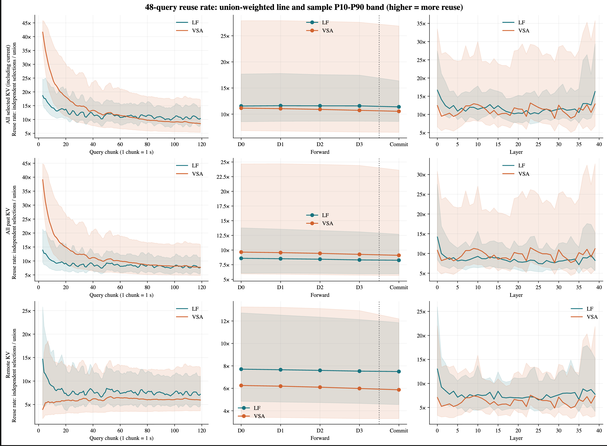
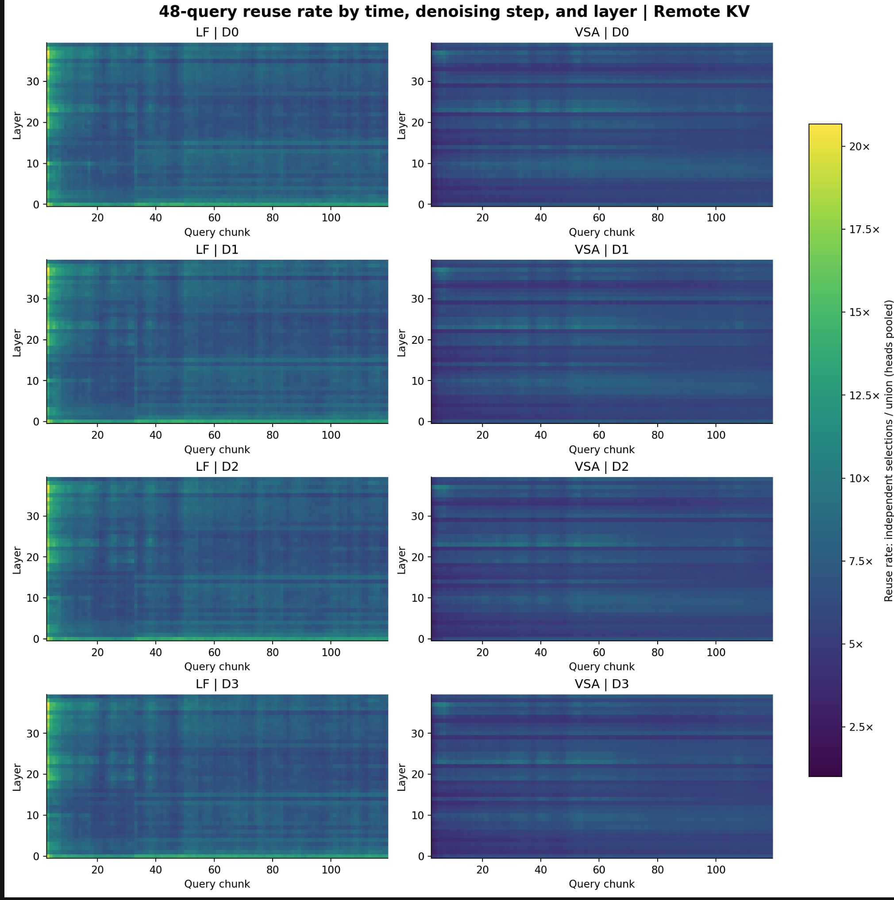

# 逻辑 attention trace：LingBot-World 14B，完整历史 KV + 块稀疏选块

> 目的：给硬件建模（Tianqi）用的逻辑访问 trace——每个 chunk、每个去噪步、每层、每个 head、每个 query 块 attend 到哪些 KV 块。和并行方式、硬件参数无关。
> 数据：本仓库 `data/attn_trace/vsa/`、`data/attn_trace/lf/`，用 Git LFS 存（`.lfsconfig` 设了 `fetchexclude`，普通 clone 不会下载）。需要时：`git lfs pull --include "data/attn_trace/**" --exclude ""`（只要一种策略就把 `**` 换成 `vsa/**` 或 `lf/**`）。GitHub 免费额度每月 10 GiB 下载，完整下载一次约 3.4 GB。
> 生成：`profile_lingbot.py --select lightforcing --sel-stats 1 --dump-every 1`（SP8，每卡 dump 自己的 head），再用 `export_logical_trace.py` 按 head 拼回整个模型。2026-10-14。

## 1. 设置

| 项 | 值 |
|---|---|
| 模型 | LingBot-World v2 14B causal-fast（Wan2.2-14B），40 层 × 40 head，head_dim 128，bf16 |
| 分辨率 / 帧率 | 512×768，16 fps；1 个 latent 帧 = 1536 token = 12 个 128-token 块 |
| chunk | 4 个 latent 帧 = 16 帧视频 = 1 s；query = 本 chunk 的 6144 token = 48 个 query 块 |
| 每 chunk 的 forward | 5 次：0–3 是 4 个去噪步，4 是 t=0 的 commit（写入本 chunk 的 KV，也做 attention） |
| KV | 完整历史，不截断；跑 120 个 chunk（2 分钟视频） |
| attention | FA4 块稀疏，128×128 块；选块按 mean-pool 后的 q·k 打分，每层、每 head、每 query 块各自选 |

两种选块策略（同 `realtime_profile.md` 第 3 节）：

- **VSA 式（`vsa/`）**：最近 12 个 latent 帧（含当前 chunk）全看；更早的块里每个 query 块选前 5%。
- **Light Forcing 式（`lf/`）**：先选帧（sink 1 帧 + 最近 2 帧 + 打分最高的帧，共 6 个过去帧），再在选中的帧和当前 chunk 里选 50% 的块，每个 query 块约 60 块。

## 2. 格式

每个策略一个目录：`meta.json`（单位和每个 chunk 的块数）+ 每个 chunk 一个 `chunkXXXX.npz`（chunk 3–119；chunk 0–2 的历史都在 12 帧窗口内，是 dense，没有文件）。

文件里存的是 `blocks_delta`（int16，沿最后一维的差分，第一个元素就是第一个编号；比直接存编号小约 35%），`blocks = np.cumsum(blocks_delta, -1)`。

`blocks[f, l, h, q, :]` = forward `f`、第 `l` 层、第 `h` 个 head、第 `q` 个 query 块 attend 到的 KV 块编号，已排序。

- 一个 KV 块 = 某层某 head 的 128 个连续 token，K+V = 128 × 128 × 2 × 2 B = **64 KB**；`(层, head, 编号)` 唯一确定一块物理数据。
- 编号按时间排：块 `n` 是 token `[128n, 128n+128)`，属于 latent 帧 `n // 12`。
- `meta.json` 里 `total_blocks` 是该 chunk 的 cache 长度（块）；编号 `< remote_blocks` 的是最近 12 帧以外的历史（容量层要存的部分）；最后 48 个编号是当前 chunk。
- 拼接方式：Ulysses SP8 下第 r 张卡负责 head `5r..5r+4` 的全部 token，按 head 拼起来就是单卡模型的 trace；选块结果和 SP 无关。

```python
import numpy as np, json
meta = json.load(open("data/attn_trace/vsa/meta.json"))
b = np.cumsum(np.load("data/attn_trace/vsa/chunk0100.npz")["blocks_delta"], -1, dtype=np.int32)   # [5, 40, 40, 48, K]
ids = b[2, 10, 7, 0]                         # 第 2 步、第 10 层、第 7 个 head、第 0 个 query 块
fetch = np.unique(b[2, 10, 7])               # 对 query 块取并集 = 这一步这一层这个 head 要读的块
```

## 3. 汇总（只算最近 12 帧以外的历史）

全模型 40 层 × 40 head。"每步"= 一次 forward 内对 query 块取并集；"每 chunk"= 再对 5 次 forward 取并集。

| 策略 | chunk | 历史 KV | 每步读 | 每 chunk 读 |
|---|---:|---:|---:|---:|
| VSA 式 | 30 | 131 GB | 52 GB（40%） | 63 GB（48%） |
| VSA 式 | 60 | 272 GB | 102 GB（38%） | 121 GB（45%） |
| VSA 式 | 119 | 548 GB | 222 GB（40%） | 259 GB（47%） |
| LF 式 | 30 | 131 GB | 16 GB（12%） | 25 GB（19%） |
| LF 式 | 60 | 272 GB | 19 GB（7%） | 28 GB（10%） |
| LF 式 | 119 | 548 GB | 20 GB（4%） | 32 GB（6%） |

和 `realtime_profile.md` 第 3 节的统计一致（VSA 式每 forward 远端 37.8–40.3%，LF 式 6.8% → 3.7%）。chunk 100 与之前每 20 chunk dump 一次的运行逐位相同。

LingBot 是用 sliding window 训练的，没训练过稀疏；这里的选块来自模型自己的 q·k 分数，作为访问模式使用，不代表画质。

## 4. 复用与算术强度（Tianqi 对 trace 的分析，2026-10-14）

Tianqi 用这份 trace 统计了每个取回的 KV 块在一次 forward 内被多少个 query 块用到（复用率 = 各 query 块独立选中次数之和 / 并集）。





- **远端 KV 每块平均被约 6–7 个 query 块复用**（VSA 式约 6×，LF 式约 7–8×），基本不随时间和去噪步变化。和第 3 节一致：每个 query 块选 5%，一步并集约 40%，48 × 5% / 40% ≈ 6。
- **层上有条带**：每层的复用率在 120 s 里几乎不变，层与层之间不同，可以按层静态分配带宽或放置。LF 式在 chunk 33 左右有一个台阶，VSA 式没有，原因没查。
- **算术强度**：一对（query 块，KV 块）计算 4 × 128³ ≈ 8.4 MFLOP，读 64 KB，AI = 128 FLOP/B，和 KV 长度无关。按 FA4 约 650 TFLOP/s，不合并时需约 5 TB/s 读带宽；一步内合并 48 个 query 块的请求后 AI 约 770（约 0.85 TB/s）；再在 5 次 forward 间缓存（一 chunk 的并集只比单步多约 17%）AI 约 3300（约 0.2 TB/s）。所以 far memory 一侧合并请求有好处。
- 注意 VSA 式按比例选 5%，选中的块数随历史线性增长：AI 不变，但计算量会涨（10 分钟时 attention 约 1 s）。要让计算有上限需改成固定 k。
