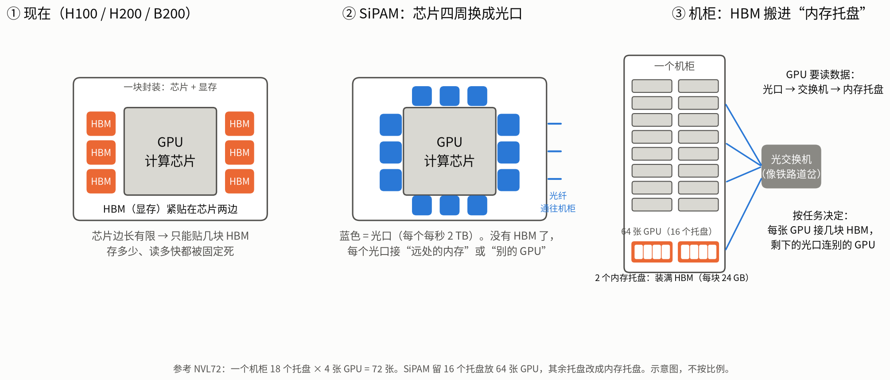
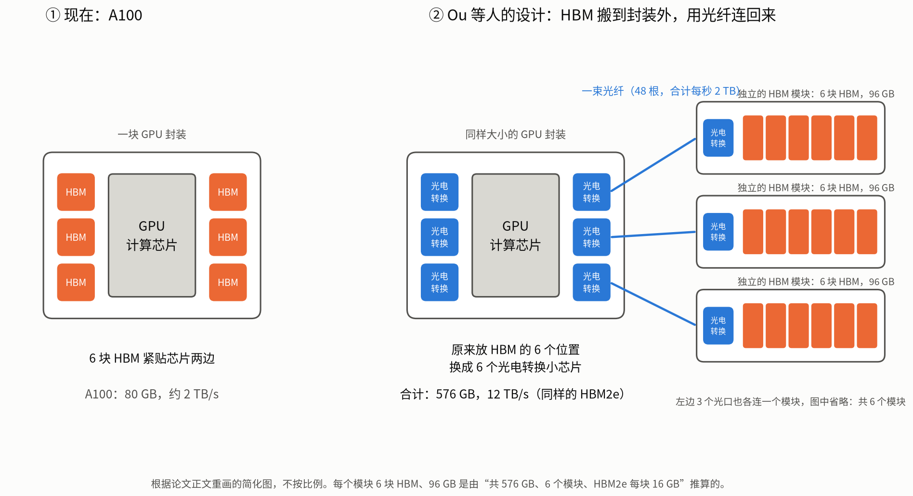
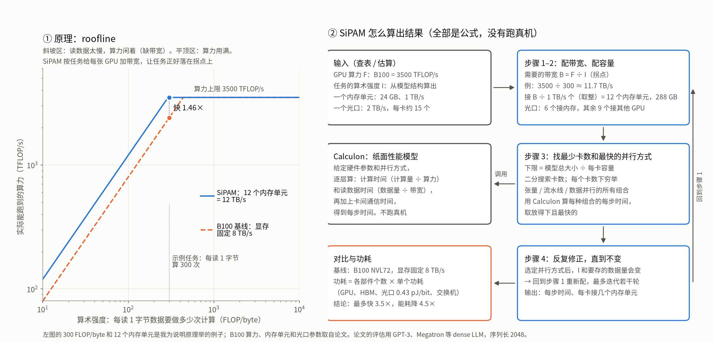

# 光互连内存池论文：SiPAM 与光连 HBM，以及我们的小 work 方向（2026-10-30）

> 两篇论文的 PDF 在仓库根目录。本文先用简单的话讲清楚它们做了什么、怎么算的，再讲我们的 workload 和它们的假设哪里不同，最后是一个小 work（短文）的方案。
> 我们 workload 的数字来自 `realtime_inference_estimate.md`、`realtime_profile.md` 和 `pan_measurements.md`。

## 1. 两篇论文

### 1.1 光连 HBM（Ou、Zhang、Rovinski、Wentzlaff、Batten，IEEE CAL 2025）

- **题目**：Optically Connected Multi-Stack HBM Modules for Large Language Model Training and Inference，IEEE Computer Architecture Letters 24(1)，49–52 页，DOI 10.1109/LCA.2025.3540058。4 页短文。
- **做法**：A100 芯片旁边原来放 6 块 HBM 的位置，换成 6 个光电转换小芯片（EIC-PIC）；每个用一束光纤（48 根，16 个光通道，合计 2 TB/s）连到封装外一个独立的 HBM 模块。同样的 HBM2e，从约 80 GB、2 TB/s 变成 **576 GB、12 TB/s**。每个模块 6 块 HBM、96 GB 是我们按"576 GB、6 个模块、每块 16 GB"推算的。
- **评估**：用纸面性能模型 LLMCompass，A100 8 卡节点为基线。
  - 训练 1T 参数模型、4096 卡：MFU 提升 1.4 倍，主要来自容量（少切模型、不用重算激活），不是带宽。
  - 推理（batch 8）：decode 快 1.5–1.7 倍；如果把 GPU 内部 L2 从 7 TB/s 提到 24 TB/s，快 3.2–4.2 倍。外接内存比 GPU 内部缓存还快，新瓶颈在片内（"bandwidth inversion"）。
- **性质**：每张 GPU **私有**的外接内存，光纤直连，不经过交换机，不能按任务重新分配。

### 1.2 SiPAM（Wu、Wang、Bergman，Columbia；IEEE Micro 2026 年 7/8 月，Hot Interconnects 专题）

- **出处**：DOI 10.1109/MM.2026.3670009，CC BY 4.0。是作者 HOTI 2025 论文的扩展版。第一作者现在在 NVIDIA；同一作者的 ACTINA（光电路交换网络）发在 SC 2025。
- **做法**：GPU 芯片四周全部换成硅光 I/O（每卡最多 240 Tb/s，约 30 TB/s；每个 I/O 2 TB/s），**去掉本地 HBM**。机柜里 64 张 GPU（NVL72 的 18 个托盘留 16 个），其余托盘改成装 HBM 的"内存托盘"（每个内存单元 24 GB、1 TB/s）。每个 I/O 可以分给"读写内存池"或"连别的 GPU"，经光电路交换机（OCS，BCube 拓扑）切换。
- **结果**：快最多 3.5 倍，能耗降最多 4.5 倍（对比 B100 NVL72）。

### 1.3 SiPAM 是怎么算出结果的

1. **输入**：GPU 峰值算力 F（B100 = 3500 TFLOP/s）、任务的算术强度 I（每读 1 字节算多少次，由模型结构算出）、内存单元 24 GB / 1 TB/s、光口 2 TB/s。
2. **配带宽和容量**（roofline 拐点）：需要的带宽 B = F ÷ I；接 ⌈B ÷ 1 TB/s⌉ 个内存单元，容量随之确定；⌈B ÷ 2 TB/s⌉ 个光口接内存，其余接网络。
3. **找卡数和并行方式**：下限 = 模型总大小 ÷ 每卡容量；二分搜索卡数，每个卡数下穷举张量 / 流水线 / 数据并行组合，用纸面模型 Calculon 算每步时间，取放得下且最快的。
4. **迭代**：选定并行方式后 I 和容量需求会变，回到第 2 步，直到不变。
5. **功耗**：各部件个数 × 单个功耗（GPU、HBM3e 每块 32 W、光链路 0.43 pJ/bit、交换机）。

**没有真机，也没有真实 trace**。workload 是 GPT-3 175B、Megatron-1T 等 dense LLM，序列长 2048，只用模型结构参数。推理只报一个"单步时间"，不分 prefill / decode，没写 batch，全文没有 KV cache。配置在任务开始前算一次，之后不变。

### 1.4 两篇对比

| | 光连 HBM（Ou 等） | SiPAM |
|---|---|---|
| HBM 放在哪 | 每张 GPU 私有的外接模块 | 机柜里共享的内存托盘 |
| 连接 | 光纤直连 | 经光电路交换机，可重新分配 |
| 本地 HBM | 没有（位置换成光电转换芯片） | 没有 |
| 按任务调整 | 不能 | 能（每卡接几个内存单元） |
| 评估 | LLMCompass 纸面模型 | Calculon 纸面模型 |
| 发表 | IEEE CAL（4 页短文） | IEEE Micro 专题文章（杂志，中等水平） |

## 2. 我们的 workload 和它们的假设哪里不同

| | SiPAM 的假设 | 实时 causal 视频 + 稀疏 attention |
|---|---|---|
| 配置的时间尺度 | 每个任务一次 | 每个 chunk 约 0.67 s，每轮取数约 3 ms（44 层 × 5 次 forward = 220 轮） |
| 算术强度 | 固定 | 随层（取数量差 3 倍）、去噪步、历史长度、内容变化 |
| 访问方式 | 大块流式 | 打分后才知道取哪些块；29–148 KB 的小块随机读 |
| 容量 | 固定 | 随历史线性增长，每路流每秒视频约 5 GB（LingBot 14B 实测） |
| 瓶颈 | 带宽（为带宽多配容量） | 容量（为容量多配了带宽） |

720p、10 分钟、每路流切 6 个 tile 时：每 tile 要存约 450 GB KV；全用 HBM 单元（24 GB）要接约 19 个，带宽约 19 TB/s，而取数平均只要约 0.8 TB/s、峰值约 1.8 TB/s，**带宽多配 10–25 倍**；19 块 HBM3e 按每块 32 W 约 600 W，和 GPU 本身相当。

"每秒要读的量 ÷ 存储量"：

| | 比值 |
|---|---|
| 我们的需求，均值到峰值 | 约 1.7–4 |
| 加上跨去噪步复用缓存后 | 约 0.4–1 |
| HBM3e（24 GB、1 TB/s） | 约 42 |
| LPDDR5X（Grace：480 GB、512 GB/s） | 约 1.1 |

## 3. 可以做的设计点

1. **异构内存池，按容量和带宽两维配置**（主推）：完整历史放 LPDDR 级的大容量单元，HBM 单元只放热数据和权重。SiPAM 的 roofline 分配从一维（带宽）变成二维（带宽 + 容量），比较能耗和成本。
2. **光交换重配置时间和取数节奏对不上**：MEMS 光交换机重配置一般是毫秒到几十毫秒（我们的了解，SiPAM 没写，待核实），每轮取数只有约 3 ms，不能每轮换线。连接按 chunk 级调整，轮内在已有连接上调度。
3. **放置配合电路连通性 + 多流错峰**：按 head 切分时，每张卡负责的 head 的 KV 放在它直连的内存单元上；8 路流错开相位时峰值 / 均值从 2.3 降到 1.4，但电路交换下空闲带宽不能自动借给别的流。
4. **少一次往返、小块打包**：先打分再取数要两次往返；在内存侧就近打分可以变一次。小块随机读要分散到多条波长和多个 HBM 通道。
5. **本地缓存和远端池的比例**：相邻去噪步选择只变约 7%，相邻 chunk 约 63% 可复用。把 SiPAM 的"I/O 分给内存还是网络"扩成三选一：本地缓存、远端池、卡间网络，用 trace 扫最优比例。

## 4. 小 work 方案（短文，不做大 paper）

**一个结论**：实时视频 world model 的内存池缺容量不缺速度，全 HBM 的光互连内存池（如 SiPAM）是浪费的，应该大部分用便宜的大容量内存。

**三张图**：
1. 容量墙：每路流 KV 随视频长度增长 vs 每卡显存（已有：LingBot 实测，引文见 `../survey/kv_cache_memory_quotes.md`）。
2. "每秒读量 ÷ 存储量"：我们的需求 vs HBM / LPDDR（已有：trace 统计）。
3. 内存池配置：全 HBM 池 vs HBM + LPDDR 混合池 vs NVL72 + Grace LPDDR，N 路流下的内存量和功耗（要新写计算脚本；功耗参数借用 SiPAM）。

**工作量**：约 1–2 周。**投稿**（日期见 `../survey/venues_and_timeline.md`，投前核对官网）：DATE 2027 Late Breaking Results（2 页，2026-11-29 截稿）或 IEEE CAL（4 页，随时投）。

**待定**：投哪一个；先和导师 / David 对一下讲法——"带宽其实不用那么高"和 GlassML 的"大容量 + 高带宽"有张力。
