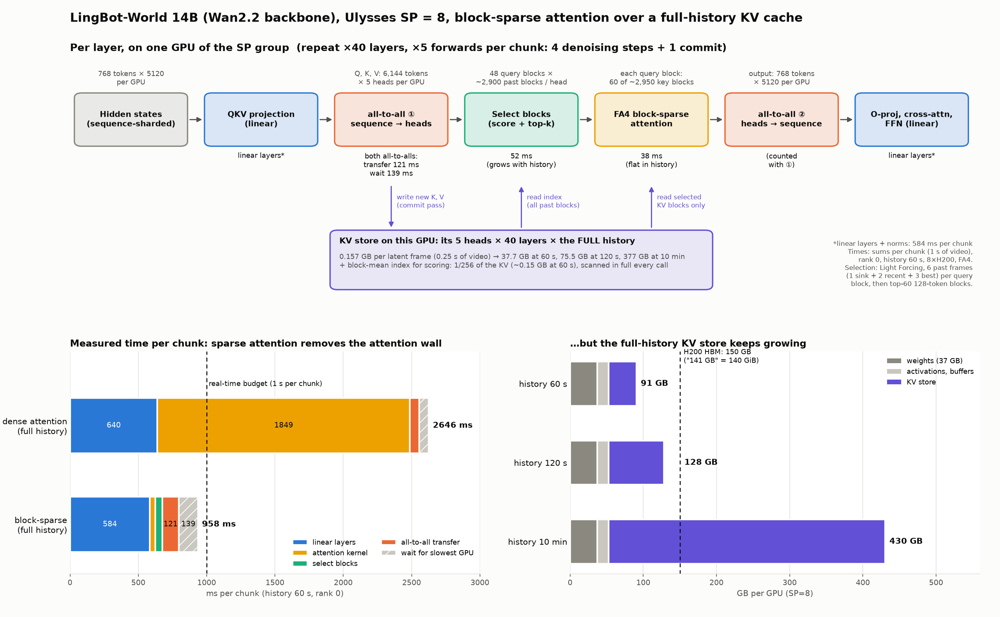

# 实测：长 KV 的实时 causal 视频模型（LingBot-World v2 14B、Cosmos-H-Dreams）

> 目的：在开源的实时 causal world model 上实测"长历史 KV"的代价，补充 `realtime_inference_estimate.md` 的估算。sliding window 不需要大 KV 存储，所以只作基线；重点是**完整历史**和**存全量 KV + 选块**两种情形。
> 机器：1 台 8×H200（141 GB HBM，NVLink），attention 用 **FlashAttention 4**（`flash-attn-4` 4.0.0b8）。
> 代码在 worktree `exp/realtime-profile` 的 `experiments/realtime_profile/`（`profile_lingbot.py`、`kv_select.py`、`lf_select.py`、`profile_cosmos.py`、`bench_fetch.py`、`plot_sp_sparse_workload.py`），原始数据在其 `runs/`。
> 2026-10-10 测第 1–5、7–9 节；2026-10-14 补第 3 节（块稀疏 attention + SP 的 workload、选块策略与 locality）；2026-10-15 补第 6 节（存 KV vs 存 latent 重算：速度和画质）。

## 结论

1. **完整历史 + dense attention 做不到实时。** LingBot 14B 在 8 卡（SP8）上每个 chunk（1 s 视频）= 0.63 s + 8.1 ms × 历史 latent 帧数；历史超过约 11 s 就超出 1 s 预算，120 s 时要 4.5 s（慢 4.5 倍），attention 占 81%，FA4 跑在约 610–680 TFLOP/s，是算力瓶颈。
2. **选块能恢复实时，但必须存全量 KV。** 每个 head 只看 sink + 选中的远端块 + 最近 12 帧时，120 s 历史下每 chunk 0.95–1.05 s，和 sliding window（0.90 s）相近；但每卡要存 74 GB KV（8 卡 593 GB），而 sliding window 只要 2.8 GB。10 分钟约 3 TB，8 张 H200 放不下。
3. **SP 的通信不是瓶颈。** Ulysses 只传激活，纯传输每 chunk 63–84 ms（6–8%），不随历史增长；随历史增长的是"等最慢的卡"。
4. **SP 只能扩容量，不能让完整历史变快。** 每卡存满时（SP1 到 SP8 分别能存 16 s 到 120 s），每 chunk 都要 4.4–5.4 s。
5. **把冷 KV 放到容量层，带宽和粒度是关键。** H200 节点上 CPU 内存 → GPU 实测每卡约 28 GB/s（整机 223 GB/s），按 head 取 29 KB 的碎块只有约 5 GB/s。LingBot 选 5% 时，120 s 历史每卡每秒要取约 3.4 GB，10 分钟要约 17 GB/s，用 PCIe 已经接近预算。
6. **块稀疏 attention（Light Forcing 的选块 + FA4 块稀疏 kernel）让完整历史也能实时，但 KV 照样线性增长。** 14B、SP8、历史 60 s：每 chunk 0.96 s（dense 2.65 s），attention kernel 只要 38 ms 且不随历史变化；选块要扫全部历史的块均值索引，随历史线性增长（60 s 时 52 ms）。每卡 KV 仍是 0.157 GB / latent 帧，10 分钟 377 GB。
7. **locality 主要由选块策略决定，不是由有没有训练过稀疏决定。** 同一个没训练过稀疏的 LingBot 14B：VSA 式（按比例直接选块）和上一个 chunk 重合约 70%、相邻 forward 新增约 7%，和训练过 VSA 的 PAN 一致（63–65%、约 7%）；Light Forcing 式（先选帧再选块）只有约 30–38%、约 16%。
8. **长期记忆要存 KV，不能只存 latent 重算。** 按相机检索记忆帧时，重算 8 帧每 chunk 多 283 ms（20 帧 757 ms），从 CPU 内存取存好的 KV 只要 46–109 ms。画质上（LingBot-Fast 14B，22.5 s 往返转头，2 个 seed），回到超出窗口的旧视角时：存 KV 检索 PSNR 16.1，完整 KV 15.5，重算 11.4–12.5，和滑动窗口 11.8 一样，即重算的 KV 带不来记忆：深层 KV 含有生成时的上下文，重算还原不了（中间层余弦相似度约 0.7）。见第 6 节。
9. **小模型（Cosmos-H-Dreams 2B，机器人）**：单卡 120 s 历史仍实时（0.82 s / 1.2 s 预算），但 10 分钟 KV 约 200 GB，单卡放不下；attention 每多 1 帧历史多 1.9 ms，约 3.4 分钟后单卡超预算。

## 1. 模型与设置

| | LingBot-World v2 14B causal-fast | Cosmos-H-Dreams |
|---|---|---|
| 领域 | 交互游戏 / 开放世界（相机和动作控制） | 手术机器人（动作控制） |
| 底座 | Wan2.2 14B（40 层，hidden 5120，40 head） | Cosmos-Predict2.5 2B（28 层，hidden 2048，16 head） |
| 生成方式 | 每个 chunk 4 个 latent 帧，4 步去噪 + 1 次 commit，KV cache | 每个 block 3 个 latent 帧，4 步，KV cache（FlashDreams） |
| 分辨率 / 帧率 | 416×928（按例图比例缩放，面积约 480×832），16 fps；1 个 latent 帧 = 1508 token | 288×512，10 fps；1 个 latent 帧 = 576 token |
| 实时预算 | 每 chunk 1.0 s | 每 block 1.2 s |
| KV / latent 帧 | 2 × 40 × 1508 × 5120 × 2 B = **1.24 GB**（约 4.9 GB / 秒视频） | 2 × 28 × 576 × 2048 × 2 B = **132 MB**（约 330 MB / 秒视频） |
| 训练窗口 | 18 帧 + 6 帧 sink | 11 帧 + 1 帧 sink |

LingBot 用自己写的循环复现官方 `_generate_causal_fast`（相同的 4 步 + commit），只去掉 VAE 解码、复用第一个 chunk 的相机条件、把 RoPE 表扩到 1024 帧以上，所以**只测系统开销，不看画质**（窗口开长后画质会偏离训练分布）。权重每卡一份完整副本：官方 `--dit_fsdp` 用 `SHARD_GRAD_OP`，推理第一次 forward 后权重就全部聚合并留在显存里，稳态下既不省显存也不多通信（实测每 chunk 0.92 s vs 0.88 s）。

## 2. LingBot 14B，8 卡 SP8：三种 KV 情形

每 chunk 的时间（ms），取最后 20 个 chunk（历史约 115 s）的平均：

| 情形 | 每 chunk | attention（kernel / 含选块） | all-to-all | 其他（线性层等） | 每卡 KV 存储 | 每卡每 chunk 读 KV |
|---|---:|---:|---:|---:|---:|---:|
| A. sliding window（18 + 6 sink） | **901** | 151 / 154 | 107 | 623 | **2.8 GB** | 14 GB |
| B. 完整历史，dense | **4231** | 3363 | 205 | 643 | **74 GB** | 341 GB |
| C1. 全量 KV + 按内容选 5% | 1054 | 256 / 382 | 70 | 584 | 74 GB | 29 GB |
| C2. 全量 KV + 按内容选 160 块 | **960** | 194 / 295 | 66 | 581 | 74 GB | 22 GB |
| C3. 全量 KV + 按相机视野选 160 块 | **954** | 194 / 288 | 64 | 583 | 74 GB | 22 GB |

- 选块：块 = 116 个 token，每个 head 对整个 chunk 选一组；C1 按 `max_query mean(q)·mean(k_block)` 打分取 top 5%，C2 取固定 160 块（约 12 帧，计算量和 A 相当），C3 按相机朝向相似度选（合成的匀速转圈轨迹）。都另外保留 4 帧 sink 和最近 12 帧。
- "含选块"减"kernel"约 100 ms 是打分加 gather，用 PyTorch 写的，没优化。

完整历史下每 chunk 时间随历史线性增长：

| 历史 | 3 s | 11 s | 31 s | 61 s | 91 s | 120 s |
|---|---:|---:|---:|---:|---:|---:|
| 每 chunk | 0.74 s | **0.99 s** | 1.64 s | 2.61 s | 3.57 s | 4.53 s |
| attention | 84 ms | 306 ms | 895 ms | 1841 ms | 2778 ms | 3649 ms |
| FA4 算力 | 676 TF/s | 673 | 646 | 618 | 611 | 613 |

### 选块的访问模式（C1，历史约 115 s）[实测]

| 量 | LingBot 14B（本次） | PAN（`realtime_inference_estimate.md`） |
|---|---:|---:|
| 每次 forward 选中的远端比例 | 5.0% | 21.8%（每个 query block 各选 5% 的并集） |
| 一个 chunk 的 5 次 forward 并集 | 7.1%（1.4×） | 26%（1.19×） |
| 和上一个 chunk 的重叠 | 37% | 63% |
| 选中块按历史位置 | 分散在整个历史，不集中在最近 | 同左 |

两者的差别主要来自选块粒度：这里每个 head 对整个 chunk 选一组，PAN VSA 是每个 query block 各选一组。按 query block 选的结果见第 3 节。

## 3. 块稀疏 attention + SP：workload 是什么样的



图：LingBot 14B、Ulysses SP=8、512×768（每个 latent 帧 1536 token = 12 个 128-token 块），完整历史 KV + Light Forcing 选块。上：一层在一张卡上的数据流（×40 层 × 5 次 forward）。左下：每 chunk 实测时间。右下：每卡显存随历史的增长。由 `plot_sp_sparse_workload.py` 从实测数据生成。

### 3.1 实现

- 选块直接用 **Light Forcing 的代码**（`LightForcing/wan/modules/kernel.py`，`get_sm_90_100_block_map`），attention 用 **FA4 块稀疏 kernel**（`flash_attn.cute`，128-token 块），接在 LingBot 原有的 Ulysses SP 上（all-to-all 后每卡有 5 个 head、整个 chunk 的 6,144 个 token）。
- Light Forcing 的长视频配置是 12 帧滚动窗口；这里关掉窗口、保留完整 KV。它的 top-k 原本按"全部 key 块的比例"定，完整历史下会选到保留帧以外的块，所以改为"保留帧内块数 × 0.5"：每个 query block 看 6 个历史帧（1 sink + 2 最近 + 3 最佳）加当前 chunk，共 120 块里取 60 块。
- **修了一个人为开销**：Light Forcing 的两个选块 Triton kernel 把序列长度、key 块数、历史帧数声明成编译期常量，完整历史每个 chunk 都变长，每个 chunk 都要重新编译（约 0.4–0.5 s）。改成运行时参数后（算法不变），选块每次调用 0.2–0.28 ms（`bench_lf_select.py`）。
- 512×768 是为了让每帧 token 数是 128 的整数倍（FA4 块稀疏要求）；和 480p 的 dense 结果一致（每卡 KV 75.5 GB vs 74.1 GB）。

### 3.2 时间（14B，SP8，每 chunk = 1 s 视频，rank 0）[实测]

| | 历史 | 每 chunk | 线性层 | attention kernel | 选块 | all-to-all 传输 | 等待 |
|---|---:|---:|---:|---:|---:|---:|---:|
| dense，完整历史 | 7.5 s | 935 ms | 593 | 209 | — | 86 | 26 |
| dense，完整历史 | 60 s | **2646 ms** | 640 | 1847 | — | 66 | 71 |
| 块稀疏（Light Forcing 式），完整 KV | 7.5 s | 962 ms | 584 | 38 | 17 | 126 | 173 |
| 块稀疏（Light Forcing 式），完整 KV | 60 s | **958 ms** | 584 | 38 | 52 | 121 | 139 |

- attention kernel 不随历史变化（每个 query block 只看固定数量的块）；选块要给**全部**历史块打分，随历史线性增长（类似 DeepSeek DSA 的索引器）。
- 稀疏版的"传输 + 等待"比 dense 多：attention 变快后 GPU 更常等 CPU 发 kernel，CUDA event 把这段空闲也算了进去，待用 profiler 时间线确认。
- 显存：每卡 KV 0.157 GB / latent 帧，60 s 37.7 GB、120 s 75.5 GB、10 分钟 377 GB；另有块均值索引约为 KV 的 1/256，每次选块都要完整扫一遍。

### 3.3 选块策略与 locality [实测]

同一个 LingBot 14B（没用稀疏训练），两种选块策略各跑到 120 s。只统计比最近 12 帧更老的远端块（和 PAN 的统计口径一致）：

- **VSA 式**：最近 12 帧（3 个 chunk，含当前）精确 attend；更老的块按 Q 块均值 · K 块均值一步选 top 5%（每个 query block、每个 head）。和 PAN 的 VSA hybrid 是同一个策略。
- **Light Forcing 式**：先选帧（6 个）再选块（见 3.1）。

| 指标 | 历史 | PAN（训练过 VSA，448p） | LingBot + VSA 式 | LingBot + Light Forcing 式 |
|---|---|---:|---:|---:|
| 和上一个 chunk 重合 | ~30 s | 63% | **70%** | 38% |
| | ~60 s | 65% | **68%** | 34% |
| | ~115 s | — | **74%** | 30% |
| 相邻 forward 新增 | ~60 s | 6.7% | **7.4%** | 15.5% |
| 5 次 forward 并集 / 单次 | ~60 s | 1.19× | **1.20×** | 1.51× |
| 每次 forward 取的远端比例 | ~60 s | 21.8% | 37.8% | 6.8% |
| | ~115 s | — | 40.3% | 3.7% |
| 连续段长度（块） | ~60 s | — | 7.4 | 11.3 |
| 8 卡负载不均（最大 / 平均） | ~60 s | 1.32×（按轮） | 1.26× | 1.25× |
| attention kernel / chunk | ~60 s → ~115 s | — | 170 → 251 ms | 48 → 43 ms |

- **locality 由策略决定**：VSA 式直接在全部远端块里按比例选，选择很稳定；Light Forcing 式先选整帧，"第 3 好"和"第 4 好"的帧一换，12 个块全换，所以重合低。没训练过稀疏的 LingBot 用 VSA 式，locality 与训练过的 PAN 相当。
- **VSA 式每次取约 40%（PAN 22%）是预期的**：并集来自 48 个 query block（PAN 448p 只有 13 个）；按 PAN trace 拟合的"并集 ∝ query block 数^0.51"外推为 22% × (48/13)^0.51 ≈ 43%。
- **对 glass 是取舍**：VSA 式取得多（约 40% 的远端历史）但复用高（chunk 间约 70%），attention 计算随历史增长；Light Forcing 式取得少且随历史下降，但复用低（约 30%），光路和缓存难以复用，attention 计算不随历史增长。两者都要存完整 KV。
- 原始选块 trace（每 20 个 chunk 导出一次：每次 forward × 每层 × 每个 head × 每个 query block 选中的块号）：`runs/l14b_pol_vsa_sp8_lut/`、`runs/l14b_pol_lf_sp8_lut/`、`runs/l14b_lf_sp8_stats_lut/`。
- 这两组开着统计（有同步开销），每 chunk 时间偏高（1.15–1.36 s），时间以 3.2 节为准。

## 4. SP 卡数

| SP | 每卡能存的完整历史 | 历史 30 s 时每 chunk | 加速 | 存满时每 chunk |
|---:|---:|---:|---:|---:|
| 1 | 16 s | 4.47 s | 1× | 5.42 s |
| 2 | 32 s | 2.55 s | 1.75× | 5.14 s |
| 4 | 64 s | 1.44 s | 3.1× | 4.81 s |
| 5 | 80 s | 1.22 s | 3.7× | 4.62 s |
| 8 | 120 s | 0.88 s | 5.1× | 4.40 s |

- attention 和 KV 都按 head 分到各卡，所以能存的历史随卡数线性增长；存满时每卡的 attention 工作量一样，所以时间都差不多。
- 线性层加速比不到线性（8 卡时每卡只有约 750 个 token），8 卡总加速 5.1×。

### all-to-all：纯传输 vs 等待（每次 all-to-all 前加一个 4 字节 all-reduce 吸收等待）

| 设置 | 历史 | 纯传输 | 等待 | 实际带宽 | 每次调用 |
|---|---:|---:|---:|---:|---:|
| SP8 完整历史 | 30 s | 71 ms | 33 ms | 87 GB/s | 89 µs |
| SP8 完整历史 | 55 s | 66 ms | 73 ms | 94 GB/s | 82 µs |
| SP8 选 160 块 | 116 s | 63 ms | 19 ms | 98 GB/s | 79 µs |
| SP4 完整历史 | 28 s | 84 ms | 67 ms | 148 GB/s | 105 µs |

每 chunk 800 次 all-to-all（4 次 × 40 层 × 5 次 forward），每次约 8 MB，受调用延迟和拷贝限制，不受 NVLink 带宽限制。

## 5. 容量层取数：CPU 内存 → GPU（8 卡同时）[实测]

| 每次取的块 | 对应 | 每卡 | 整机 |
|---:|---|---:|---:|
| 29 KB | 1 块 × 1 层 × 1 head 的 K 或 V | 4.5–4.9 GB/s | 38 GB/s |
| 148 KB | 1 块 × 1 层 × 5 head（SP8 一张卡） | 23–24 GB/s | 189 GB/s |
| 1.9 MB | 1 个 latent 帧 × 1 层 | 27.8 GB/s | 222 GB/s |
| 16 MB | 连续大块 | 27.9 GB/s | 223 GB/s |

HBM → HBM 用同样的逐块拷贝，29 KB 时也只有约 4 GB/s：碎块受每次拷贝的启动开销限制，需要批量 gather kernel / DMA。

**套用到 LingBot C1（选 5%，chunk 内并集 7.1%，和上一 chunk 复用 37%）：**

| 历史 | 每卡远端 KV | 每卡每秒要取 | 148 KB 块（23 GB/s） | 29 KB 块（5 GB/s） |
|---|---:|---:|---:|---:|
| 120 s | 74 GB | 约 3.4 GB | 约 0.15 s，预算内 | 约 0.7 s，吃光预算 |
| 10 min | 约 370 GB | 约 17 GB | 约 0.74 s，加计算超预算 | 不可能 |

## 6. 长期记忆：存 KV 还是存 latent 重算 [实测]

按相机位姿检索记忆帧时（WorldKV、HY-WorldPlay、Matrix-Game 3.0 一类），被检索帧的 KV 有两种来源：存下每个 chunk 的 KV、用时取回（WorldKV），或只存干净 latent、用时再过一遍模型重算（HY-WorldPlay 式）。两者都要存全部历史，区别在存多大（KV 每秒视频约 5 GB，latent 约 0.8 MB）和每 chunk 多花多少。

### 6.1 速度（LingBot v2 14B，SP8，512×768，最近 12 帧 + M 个记忆帧，最后 10 个 chunk 平均）

| 记忆帧的来源 | M | 每 chunk | 比纯窗口多 | 取 / 写回 / 重算 | 每卡 bank |
|---|---:|---:|---:|---|---:|
| 只有 12 帧窗口 | 0 | 1016 ms | — | — | 0 |
| 存 KV，bank 在 HBM | 8 | 1034 ms | +18 | 取 8 ms（1.26 GB） | 37.7 GB |
| 存 KV，bank 在 CPU 内存 | 8 | 1073 ms | +57 | 取 46 ms + 写回 35 ms | 37.7 GB（CPU） |
| 存 latent，重算 | 8 | 1329 ms | +313 | 重算 283 ms | 0 |
| 存 KV，bank 在 HBM | 20 | 1058 ms | +42 | 取 18 ms（3.15 GB） | 37.7 GB |
| 存 KV，bank 在 CPU 内存 | 20 | 1485 ms | +469 | 取 109 ms + 写回 28 ms，其余见下 | 37.7 GB（CPU） |
| 存 latent，重算 | 20 | 1796 ms | +780 | 重算 757 ms | 0 |

- 记忆帧在 chunk 第一次 forward 时取一次，4 个去噪步和 commit 共用。取数约 27–29 GB/s，即第 5 节的大块 PCIe 带宽。
- 重算随 M 线性增长（每帧约 35–38 ms），M = 8 已超出 1 s 预算；取 KV 在 HBM 里几乎免费，从 CPU 内存取也只要 46–109 ms。
- CPU bank、M = 20 那组比"取 + 写回"多出约 330 ms：5 次 forward 都慢约 80 ms，主要体现在 all-to-all 等待（248 ms，HBM bank 时 67 ms）。原因没查清（可能是 8 卡共 302 GB pinned 内存下的主机侧争用），GPU 回收前没来得及复测。

### 6.2 画质：回到同一视角时是否一致

用 WorldKV 的代码和设置（attention 用它自带的实现，不是 FA4，不影响画质对比）：LingBot-World-Fast v1 14B（SP4，每组 4 张卡，两组并行），464×848，361 帧（22.5 s），相机轨迹 `R_L_R_L_R_L90_360` 只转不移（偏航 0↔90° 来回 3 趟）。除完整 KV 外，注意力预算都是 27 个 latent 帧（108 帧视频，约 6.75 s）。重算两种都是我们加的（WorldKV 本地分支 `glass-recompute`，`--retrieval_source`）：检索到的 chunk 用干净 latent 在 t=0 联合过一遍模型，位置放在和"存 KV + RoPE 校正"相同的虚拟位置；`recompute_sink` 再把首帧所在 chunk 一起放进去当上下文。

指标（`eval_revisit.py`）：相机不平移，所以转回某个角度时画面应和第一趟同角度的帧相同。对第一趟之后的每帧，找第一趟里偏航差 ≤ 1.5° 的帧，算 PSNR / SSIM，按两帧相隔是否超过窗口分组。

| 配置 | 相隔 > 窗口：PSNR（seed 42 / 43） | 相隔 > 窗口：平均 PSNR | 相隔 > 窗口：平均 SSIM | 相隔 ≤ 窗口：平均 PSNR |
|---|---:|---:|---:|---:|
| 滑动窗口 27 帧 | 12.35 / 11.23 | 11.8 | 0.325 | 17.3 |
| 完整 KV | 15.98 / 14.95 | 15.5 | 0.411 | 17.3 |
| **存 KV + 按相机检索 18 帧**（WorldKV） | 16.40 / 15.83 | **16.1** | **0.426** | 17.0 |
| 存 latent，重算检索的 18 帧 | 12.48 / 12.42 | 12.5 | 0.344 | 17.4 |
| 存 latent，重算时加首帧 chunk | 11.16 / 11.65 | 11.4 | 0.320 | 17.5 |

每组 210 帧相隔超过窗口、60 帧在窗口内。WorldKV 论文 Table 1 的对应值是滑动窗口 12.18、完整 KV 15.90、WorldKV 15.66。

- **重算等于没有长期记忆**：同样检索 18 帧，存 KV 是 16.1，重算是 11.4–12.5，和滑动窗口（11.8）一样。参照帧还在窗口内时所有配置都在 17 左右，差别全部来自长期记忆。
- **原因：深层 KV 带着生成时的上下文。** 直接比较同一 chunk 重算的 V 和存下的 V（V 不带 RoPE），余弦相似度：

| 层 | 0 | 10 | 20 | 30 | 39 |
|---|---:|---:|---:|---:|---:|
| 只用检索帧重算 | 1.000 | 0.86–0.91 | 0.73–0.81 | 0.68–0.76 | 0.89–0.91 |
| 加首帧 chunk（第 8 个 chunk 起） | 1.000 | 0.87–0.91 | 0.75–0.81 | 0.69–0.74 | 0.90–0.92 |

  第 0 层完全相同，说明输入（latent、相机、时间步、位置）和当初一致；之后每层经过 attention，把当初窗口里的内容混进了 KV，只拿 latent 重算还原不了。加首帧只在最早的检索点有效（chunk 4：第 20 层 0.73 → 0.94），之后每个 chunk 当初的上下文还包括它自己的窗口。要精确还原就得递归重算整段历史。
- **重算也更慢**：整段生成（含约 100 s 加载）存 KV 387 s，重算 420–445 s，与 6.1 节一致。

**含义**：不专门为重算训练的模型（这里是 LingBot，WorldKV 也不训练），"只存 latent"既慢又没有长期记忆，长期记忆必须存 KV。HY-WorldPlay 这类训练时就用重算记忆的模型可能学会利用重算的 KV，这里没测。

## 7. Cosmos-H-Dreams 2B（单卡，FA4，CUDA graph）

| KV 窗口（latent 帧） | 对应历史 | KV | 稳态每 block（含 VAE 解码） | 峰值显存 |
|---:|---:|---:|---:|---:|
| 11 + 1 sink（官方） | 4.8 s | 1.6 GB | 216 ms | 7.2 GB |
| 59 + 1 | 24 s | 7.9 GB | 314 ms | 13.7 GB |
| 299 + 1 | 120 s | 39.6 GB | 823 ms | 45.9 GB |

- 历史每多 1 个 latent 帧，attention 多约 1.9 ms；单卡完整历史约 3.4 分钟后超出 1.2 s 预算，约 6.7 分钟后显存放不下；10 分钟 KV 约 200 GB。
- 机器人这类小模型单卡就能实时，但长历史同样需要大于单卡的容量。

## 8. 对 glass 论点的含义

- **容量是硬约束**：要实时就得选块，要选块就得存全量 KV。LingBot 14B 每秒视频 4.9 GB KV，2 分钟用满 8 张 H200，10 分钟约 3 TB；Cosmos 2B 10 分钟约 200 GB。
- **SP 的互连流量小且固定**：按 head 切分后互连只传激活（每 chunk 约 5 GB / 卡），不随历史增长。glass 光互连的作用不在这里，而在**容量层的取数**和**多路流共享容量池**。
- **容量层带宽要几十 GB/s 每卡、细粒度**：PCIe + CPU 内存每卡约 28 GB/s，已经接近 10 分钟的需求；按 head 取碎块时实际带宽掉到约 5 GB/s。glass DRAM 需要在 KB 级粒度下提供远高于 PCIe 的每 tile 带宽。
- **SP 通信里主要是等待，不是传输**：纯传输受每次调用的延迟限制（约 80 µs），glass 的高带宽省不了；等待来自各卡负载不均，也不是通信问题。只有当冷 KV 放在容量层、各卡取数不均造成等待时，glass 的共享池和调度才有帮助。
- **选块策略决定能否复用光路和缓存**：按比例直接选块（VSA 式）chunk 间重合约 70%，适合"建好光路、缓存上一 chunk 的块"；先选帧再选块（Light Forcing 式）只有约 30%。
- 对应估算模型的输入：本次实测的选块并集、复用率和单 chunk 的计算时间可以替代 PAN trace 的值（见第 2、3 节表）。

## 9. 局限

- LingBot 只训练过 18 帧窗口，完整历史和选块下画质不保证；选块是推理时加的（没训练过）。第 3.3 节显示，同一策略下它的 locality 和训练过 VSA 的 PAN 一致，但其他统计量（如选中位置分布）仍可能不同。
- 选块的打分和 gather 没优化（约 100 ms），按相机选用的是合成的匀速转圈轨迹。
- 容量层取数只在第 6 节的"按相机检索记忆帧"里接进了生成循环（整帧大块）；按内容选块的细粒度取数没有端到端测（KV 仍然全部在 HBM）。
- 第 6.2 节画质只有一张图、一条 22.5 s 的轨迹、两个 seed；重算是我们的实现，模型没为此训练过。
- Cosmos 用 CUDA graph 时没法单独计 attention 时间，attention 斜率来自 graph 捕获前的 block。
- 单节点、单路流；多路流叠加没测。

## 10. 复现

在 worktree `.worktrees/realtime-profile/experiments/realtime_profile/` 下（`source env.sh`，只用 debug node 上空闲的卡）：

```bash
bash run_sweep.sh l14b_sp8_full_rep 8 --model 14b --latent-frames 480 --window -1          # B
bash run_sweep.sh l14b_sp8_win18 8 --model 14b --latent-frames 480 --window 18 --sink 6    # A
bash run_sweep.sh l14b_sp8_sel_budget 8 --model 14b --latent-frames 480 --window -1 --select content --sel-budget 160   # C2
bash run_sweep.sh l14b_sp4_full 4 --model 14b --latent-frames 256 --window -1             # SP 扫描
bash run_sweep.sh l14b_sp8_full_split 8 --model 14b --latent-frames 240 --window -1 --split-a2a 1   # 通信拆分
torchrun --nproc_per_node=8 bench_fetch.py --out runs/fetch.jsonl                          # 容量层取数
python profile_cosmos.py --blocks 110 --window 299 --sink 1 --out runs/cosmos_w299_fa4.jsonl
# 第 3 节：块稀疏（512x768，FA4 块稀疏需要 128 对齐）
R="--model 14b --height 512 --width 768 --latent-frames 480 --window -1 --split-a2a 1"
bash run_sweep.sh l14b_dense_sp8_512 8 $R
bash run_sweep.sh l14b_lf_sp8_time 8 $R --select lightforcing
bash run_sweep.sh l14b_pol_vsa_sp8 8 $R --select lightforcing --lf-policy vsa --vsa-ratio 0.05 --sel-stats 1 --dump-every 20
bash run_sweep.sh l14b_pol_lf_sp8 8 $R --select lightforcing --lf-policy lf --sel-stats 1 --dump-every 20
python bench_lf_select.py                                                                   # 选块开销 / 重编译
# 第 6 节：存 KV vs 重算
R="--model 14b --height 512 --width 768 --latent-frames 240 --window 12 --split-a2a 1"
bash run_sweep.sh l14b_mem_kvcpu_m8 8 $R --memory kvbank --bank cpu --mem-frames 8      # --bank gpu / --memory recompute
bash runs/quality/main.sh; bash runs/quality/wave2.sh                                     # 画质（WorldKV 分支 glass-recompute）
python eval_revisit.py <poses.npy> 108 name=video.mp4 ...
python plot_sp_sparse_workload.py --out /mnt/weka/home/mingjia.huo/Project-Glass/docs/figures/sp_sparse_workload   # 图（写到 main 的 docs/）
```
