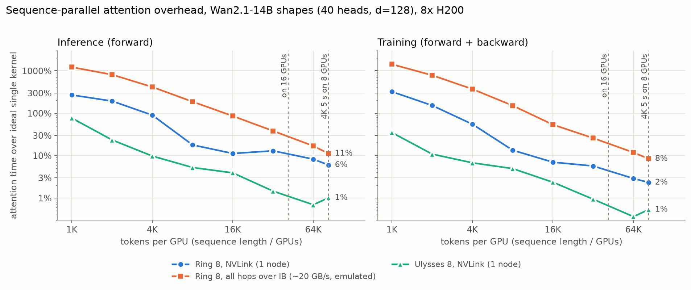

# Ring attention 的开销：单节点实测、两节点 IB 实测与多节点投影

> 2026-10-29。**[实测]** 8×H200（NVLink NV18，每卡一块 400G IB 网卡）；两节点 × 4 卡（真实 IB）。**[估]** 由实测校准的模型投影。
> 代码：`.worktrees/ring-attn/experiments/ring_attn/`（分支 `exp/ring-attn`，不 push），原始数据在其 `runs/`。

## 0. 结论

1. **为什么要 ring**：4K 视频的序列太长，一个样本要切到很多卡上；Ulysses 按 head 切，最多切到 head 数（Wan2.1-14B 有 40 个 head，16 卡除不尽），所以超过 8 卡时要么纯 ring，要么 Ulysses（节点内）× ring（跨节点）。ring 训练和推理都要用。
2. **开销由"每卡 token 数"决定**：每一步 ring，计算 ∝ (每卡 token)²，通信 ∝ 每卡 token，所以每卡 token 越多越容易把通信藏住。
   - 4K、5 s（68 万 token）切 8 卡（每卡 8.5 万）：NVLink 上 ring 只慢 **6%（推理）/ 2%（训练）**；Ulysses 只慢 1%。
   - 每卡 4K token 时：NVLink 上 ring 慢 **90% / 55%**，跨两节点时慢 **388% / 370%**。
3. **跨节点是瓶颈（两节点实测）**：8 卡 ring 跨 2 节点 × 4 卡，每卡 1.6 万 token 时慢 **73% / 54%**（NVLink 11% / 7%），每卡 8.5 万 token 时慢 **12% / 10%**（NVLink 6% / 2%）。
   - ring 的速度由最慢的一跳决定：8 跳里只有 2 跳走 IB，结果和"所有跳都走 IB"的单节点模拟只差几个百分点。
   - 节点内 Ulysses、节点间 ring（Ulysses 4 × ring 2）只慢 **2% / 2%**；Ulysses 8 直接跨节点也只慢 2% / 1%。
4. **NCCL 默认设置只用了 IB 的 40%**：ring 的收发每个网络对端默认只开 2 个通道，每卡约 **20 GB/s**（线速 50 GB/s）。设 `NCCL_NCHANNELS_PER_NET_PEER=4` 后两节点实测 **26–34 GB/s**（随分到的节点对变），跨节点 8 卡 ring 的开销约减半：每卡 1.6 万 token 时 73% / 54% → **45% / 36%**，8.5 万时 12% / 10% → **3% / 5%**。
5. **ring 实际只能藏住一部分通信**：通信比计算少时，仍有约 34%（推理）/ 40%（训练）的通信暴露出来；8 卡 ring 另有约 9% / 3% 的固定开销（NCCL 和 attention kernel 抢 SM、每步同步）。所以"带宽够就零开销"的理想模型偏乐观。
6. **NCCL 的 ring 收发在 NVLink 中等消息上很慢**：8 卡 NVLink ring 里，16–64 MB 的消息只有 65–80 GB/s，单独一对卡同样大小有 240 GB/s，≥512 MB 才到 350 GB/s。每卡 token 少时，ring 的 KV 块正好落在这个区间。
7. **投影（4K、5 s，Wan2.1-14B，推理 | 训练）**：
   - 节点之间走 IB（NCCL 默认）：纯 ring 16 卡多 25% | 23%，ring 64 卡多 145% | 113%；Ulysses 8 × ring 2–8 只多 3–23%。每个对端开 4 个通道后 ring 16 为 20% | 17%，ring 64 为 80% | 61%。
   - 换成 NVL72 级（0.9 TB/s）或 glass（4 TB/s）的域，所有 dense 配置都在 17% 以内，NVL72 和 glass 差别不大（剩下的是固定开销，不是带宽）。
   - **稀疏 attention 让 ring 更吃带宽**：计算降到 13.5% 时，Ulysses 8 × ring 8（64 卡）推理在 IB 上多 115%（默认）/ 61%（4 通道），NVL72 18%，glass 16%；纯 ring 64 是 1315% / 833% / 27% / 18%。

**和项目的关系**：dense 的 4K 视频 attention 计算量太大，带宽好藏；真正吃带宽的是"每卡 token 少"（卡多、序列相对短）和"attention 变稀疏"两种情况。稀疏 attention + ring 把我们之前的稀疏故事从推理扩展到训练：稀疏省了计算，但 ring 每一步仍要传完整的 KV 块，通信藏不住。

## 1. 设置

| 项 | 值 |
|---|---|
| 形状 | Wan2.1-14B：40 head × 128 维，bf16；block 的线性层（self / cross attention 投影 + FFN 13824）用来换算整层开销 |
| 4K、5 s | 3840×2160、81 帧 → 21 个 latent 帧 × 135 × 240 = **680,400 token** |
| 实现 | ring-flash-attn 0.1.8（ring：非 causal；zigzag：causal）+ flash_attn 2.8.4；Ulysses 用 all-to-all + 单卡 flash_attn；USP = Ulysses × ring |
| 环境 | torch 2.11、NCCL 2.28.9；ring 组同时跑满 8 卡（例如 P=2 时 4 个 ring 并行，和 DP × SP 训练一样） |
| IB 模拟 | `NCCL_P2P_DISABLE=1 NCCL_SHM_DISABLE=1`：节点内的流量也走网卡（GPUDirect RDMA，经交换机回环），实测约 **20 GB/s/卡**，和第 5 节两节点真实 IB 一致 |
| 两节点 | lowprio 分区 2 节点 × 4 卡（`ring_2node.sbatch`），GPUDirect RDMA 开启；NCCL 默认设置测 1 次（1 对节点），4 通道测 2 次（2 对不同节点，取平均） |

**每个配置测 4 个时间**（单层 attention，每卡，3 次取中位数，取最慢的卡）：

| 时间 | 含义 |
|---|---|
| ideal | 一个 flash_attn 内核做完本卡那份计算（N/P 个 query × N 个 key），没有通信 |
| compute | 同样的 ring 循环，但把通信换成本地 KV：多出来的是"拆成 P 个小内核 + 合并 softmax"的开销 |
| comm | 只做 KV 轮转，不算 attention：得到实际带宽 |
| dist | 真实的分布式 attention |

开销 = dist / ideal − 1；整层开销 = (dist − ideal) / (ideal + 线性层)。68 万 token 时 attention 占整层 98%，所以两者几乎一样。

正确性：ring / zigzag / Ulysses 的输出和梯度与单卡 flash_attn 的相对误差都 < 1%（bf16 精度），单节点和两节点都验证过。

## 2. 单节点结果（8 卡，P = 8）



attention 开销 / 整层开销，推理（forward）| 训练（forward + backward）：

| 实现 | 链路 | 每卡 4K token | 每卡 16K | 每卡 85K（4K 视频） |
|---|---|---|---|---|
| ring（dense） | NVLink | 90% / 62% \| 55% / 41% | 11% / 10% \| 7% / 6% | **6% / 6% \| 2% / 2%** |
| zigzag（causal） | NVLink | 175% / 95% \| 89% / 55% | 7% / 5% \| 8% / 7% | ≈0 \| 3% / 3% |
| Ulysses（dense） | NVLink | 10% / 7% \| 7% / 5% | 4% / 3% \| 2% / 2% | 1% / 1% \| 1% / 1% |
| Ulysses 4 × ring 2（dense） | NVLink | 21% / 15% \| 13% / 10% | 7% / 6% \| 6% / 5% | 6% / 6% \| 2% / 2% |
| ring（dense） | IB 模拟 | 415% / 287% \| 370% / 273% | 86% / 76% \| 54% / 49% | 11% / 11% \| 8% / 8% |
| zigzag（causal） | IB 模拟 | 775% / 425% \| 704% / 435% | 174% / 142% \| 141% / 121% | 16% / 15% \| 18% / 18% |
| Ulysses（dense） | IB 模拟 | 54% / 37% \| 26% / 19% | 12% / 11% \| 7% / 6% | 3% / 2% \| 1% / 1% |
| ring（dense） | IB 模拟，4 通道 | 233% / 161% \| 181% / 135% | 45% / 40% \| 30% / 28% | 3% / 3% \| 4% / 4% |
| zigzag（causal） | IB 模拟，4 通道 | 436% / 239% \| 369% / 231% | 88% / 72% \| 56% / 48% | 4% / 4% \| 10% / 9% |

- **Ulysses 一直比 ring 便宜**：Ulysses 每卡收发的量和卡数无关（约 4 × 每卡 token），ring 每卡要收齐其他所有卡的 KV（约 2 × (P−1) × 每卡 token），8 卡时是 Ulysses 的约 4 倍。只是 Ulysses 受 head 数限制。4 通道对 Ulysses 没有帮助（all-to-all 本来就同时连着多个对端）。
- **causal 比 dense 更难藏**：causal 每步计算减半，通信不变，所以平衡点翻倍。
- **训练比推理好藏**：训练整步的计算是 forward 的 3.5 倍，通信约 4 倍（KV 再传一次 + fp32 的 dK、dV），比例接近；但 backward 每一步的计算更长，实测能藏住的通信更多（3.1 节 η 0.82 vs 0.50）。
- 每卡 85K token 时，4 通道的 IB（3%，模拟和两节点都是）反而比 NVLink（6%）低。推测是 NVLink 上 NCCL 用 SM 拷贝、和 attention 抢 SM，而 IB 走 RDMA 占的 SM 少；未验证。

## 3. 开销从哪来

### 3.1 通信 / 计算比 x 决定大部分开销

把每个配置的"暴露时间" (dist − compute) / compute 对 x = comm / compute 画出来，NVLink、IB 模拟和两节点落在同一条线上，拟合为：

暴露 / 计算 = max(β·x, x − η) + φ

| | β（x < 1 时暴露的份额） | η（x > 1 时能藏住的计算时间） | φ（8 卡 ring 的固定开销） |
|---|---:|---:|---:|
| 推理 | 0.34 | 0.50 | 8.7% |
| 训练 | 0.40 | 0.82 | 3.2% |

- 理想重叠是 β = 0、η = 1：通信比计算少就完全藏住。实测只藏住一部分，因为 NCCL 的收发内核和 attention 同时占用 SM，且 ring 每一步都要等最慢的卡。
- φ 只出现在 ≥ 3 卡的 ring（2 卡没有），和带宽无关：每卡 8.5 万 token 时 NVLink 传输时间只占计算的 1%，开销仍有 6–9%。**更快的互连去不掉这一部分。**

### 3.2 NCCL ring 收发的带宽（`bench_p2p.py`）

每卡收到的 GB/s：

| 每条消息 | 8 卡 ring（NVLink） | 单独一对卡（NVLink） | 8 卡 ring（IB 模拟） | 8 卡 ring 跨 2 节点 | 跨节点 4 对同时 | 8 卡 ring（IB 模拟，4 通道） | 8 卡 ring 跨 2 节点，4 通道 |
|---:|---:|---:|---:|---:|---:|---:|---:|
| 16 MB | 67 | 146 | 18 | 18 | 17 | 30 | 22 / 29 |
| 64 MB | 79 | 241 | 19 | 19 | 18 | 34 | 26 / 32 |
| 128 MB | 156 | 274 | 19 | 19 | 19 | 34 | 26 / 33 |
| 512 MB | 351 | — | 20 | 20 | 17 | 35 | 27 / 34 |

- ring 的一个 KV 块 = 每卡 token × 40 head × 128 × 2 B，每卡 4K token 时是 42 MB。
- **NVLink**：≥ 3 卡的 ring（每卡同时发给一个邻居、从另一个邻居收）在 16–128 MB 比 2 卡互发慢 2–3 倍。试过 `NCCL_MIN_P2P_NCHANNELS`、`NCCL_P2P_NVL_CHUNKSIZE`、`NCCL_P2P_SCHEDULE_GROUP_SIZE`，都没有改善；`NCCL_P2P_USE_CUDA_MEMCPY`（copy engine，不占 SM）在所有大小都只有约 70 GB/s。原因未确认。
- **IB**：默认每卡只有约 20 GB/s，和单节点模拟、跨节点 ring、跨节点成对都一样，所以不是网卡共用或拓扑的问题，而是 NCCL 每个网络对端默认只开 2 个通道（`NCCL_NCHANNELS_PER_NET_PEER`）。改成 4：单节点模拟 35 GB/s（8 也是 35），两节点 26–34 GB/s（最后一列是两对不同节点，跨节点成对的数和 8 卡 ring 相同；同一对节点上测带宽时另一个作业还没开始，所以差别来自节点本身）。

## 4. 投影：4K、5 s，Wan2.1-14B [估]

模型（`model_ring.py`）：每步通信时间用实测的带宽–消息大小曲线；暴露时间用 3.1 节的拟合；拆内核的开销按每卡 token 数取实测值。在实测数据上的误差（每卡 ≥ 8K token）：中位数 2.8%（NVLink）/ 4.1%（IB 模拟）/ 3.8%（IB 模拟，4 通道）/ 2.9%（两节点）/ 2.6%（两节点，4 通道）；最大 15% / 19% / 16% / 51% / 25%（两节点最大的一个是第 5 节的网络抖动点）。IB 4 通道一列用两节点实测的带宽曲线（两对节点的平均，约 31 GB/s）。NVL72 和 glass 用 NVLink 单对卡曲线的形状、按峰值缩放，计算按 H200。

attention 开销，推理 | 训练（单节点配置各列相同）：

| 配置 | 卡数 | IB，NCCL 默认（20 GB/s） | IB，4 通道（约 31 GB/s） | NVL72 级（0.9 TB/s） | glass（4 TB/s） |
|---|---:|---|---|---|---|
| ring 8（1 节点） | 8 | 9% \| 4%（实测 6% \| 2%） | 同左 | 同左 | 同左 |
| Ulysses 8（1 节点） | 8 | 0% \| 0%（实测 1% \| 1%） | 同左 | 同左 | 同左 |
| ring 16 | 16 | 25% \| 23% | 20% \| 17% | 11% \| 5% | 11% \| 5% |
| Ulysses 8 × ring 2 | 16 | 3% \| 4% | 3% \| 3% | 2% \| 2% | 2% \| 2% |
| Ulysses 8 × ring 4 | 32 | 16% \| 11% | 15% \| 10% | 13% \| 7% | 13% \| 7% |
| Ulysses 8 × ring 8 | 64 | 23% \| 21% | 20% \| 18% | 16% \| 12% | 16% \| 12% |
| ring 64 | 64 | 145% \| 113% | 80% \| 61% | 17% \| 14% | 16% \| 12% |
| causal：ring 64 | 64 | 328% \| 303% | 197% \| 166% | 19% \| 16% | 16% \| 13% |
| **稀疏（计算 13.5%）**：ring 16 | 16 | 272% \| 256% | 160% \| 136% | 13% \| 8% | 12% \| 6% |
| **稀疏**：Ulysses 8 × ring 8 | 64 | 115% \| 90% | 61% \| 56% | 18% \| 14% | 16% \| 13% |
| **稀疏**：ring 64 | 64 | 1315% \| 1329% | 833% \| 822% | 27% \| 25% | 18% \| 15% |
| **稀疏 + causal**：Ulysses 8 × ring 8 | 64 | 267% \| 257% | 160% \| 137% | 20% \| 16% | 17% \| 13% |
| **稀疏 + causal**：ring 64 | 64 | 2667% \| 2735% | 1703% \| 1720% | **37% \| 38%** | **21% \| 18%** |

- 不标 causal 的行都是双向（Wan2.1，非 causal）；causal 每步计算减半、通信不变。稀疏的 13.5% 来自 PAN（causal 模型）的训练 trace；如果它是相对 dense causal 的比例，稀疏 + causal 行是对的；如果是相对 dense 全注意力，这两行把 causal 的减半算了两次，真实值在稀疏和稀疏 + causal 两行之间。
- 这些都是整段序列的一次 forward / backward（扩散的一步、训练的一步），不是带 KV cache 的分块 causal 解码；分块解码每步计算更少，更吃带宽，没有建模。
- **平衡点**（每个 ring 成员至少要多少 token 才藏得住通信，= 算力 / 带宽，causal 翻倍）：H200 NVLink 约 1.0K，IB 默认约 19K，IB 4 通道约 12K，NVL72 约 0.4K，glass 约 0.1K。
- **算力越快，越吃带宽**：换成 GB300 级算力（约 2.5×）时平衡点都乘 2.5，IB 默认约 48K、4 通道约 31K；4K 视频切 16 卡后每卡只有 42K。此时 ring 16 推理在 IB 上多 65%（默认）/ 34%（4 通道），稀疏时多 741% / 461%；NVL72 和 glass 仍是 12% / 11%（稀疏 17% / 12%）。
- NVL72 和 glass 在 dense 下几乎一样：剩下的是 3.1 节的固定开销和拆内核开销，和带宽无关。glass 的优势只在"稀疏 + 卡多"时明显（ring 64 稀疏：27% → 18%；GB300 级算力下 43% → 22%）。

## 5. 两节点实测（真实 IB，2 节点 × 4 卡）

lowprio 作业。NCCL 默认设置，attention 开销 / 整层开销，推理 | 训练：

| 实现 | 每卡 4K token | 每卡 16K | 每卡 85K（4K 视频） |
|---|---|---|---|
| ring 8（2 跳跨节点） | 388% / 268% \| 370% / 275% | 73% / 65% \| 54% / 49% | **12% / 12% \| 10% / 10%** |
| zigzag 8（causal） | 737% / 406% \| 707% / 443% | 163% / 133% \| 142% / 121% | 19% / 19% \| 19% / 18% |
| Ulysses 4 × ring 2（ring 跨节点） | 67% / 46% \| 55% / 41% | 16% / 14% \| 14% / 13% | **2% / 2% \| 2% / 2%** |
| Ulysses 8（all-to-all 跨节点） | 46% / 32% \| 23% / 17% | 6% / 6% \| 6% / 6% | 2% / 2% \| 1% / 1% |

4 通道（`NCCL_NCHANNELS_PER_NET_PEER=4`，两对节点的平均）：

| 实现 | 每卡 4K token | 每卡 16K | 每卡 85K（4K 视频） |
|---|---|---|---|
| ring 8（2 跳跨节点） | 264% / 181% \| 237% / 176% | 45% / 41% \| 36% / 34% | **3% / 3% \| 5% / 5%** |
| zigzag 8（causal） | 504% / 276% \| 474% / 295% | 116% / 94% \| 79% / 67% | 5% / 4% \| 11% / 10% |
| Ulysses 4 × ring 2（ring 跨节点） | 52% / 36% \| 32% / 24% | 11% / 10% \| 10% / 9% | ≈0 \| 1% / 1% |
| Ulysses 8（all-to-all 跨节点） | 38% / 26% \| 19% / 14% | 6% / 5% \| 5% / 5% | 1% / 1% \| 1% / 1% |

两对节点重复测的配置之间差 0–4 个百分点（zigzag 每卡 85K 推理差 6 个百分点：8% vs 2%）。

跨节点 2 卡 ring（4 对同时，每对一卡在一个节点，NCCL 默认）：每卡 32K / 64K token 时训练开销 17% / 8%，和单节点 IB 模拟（16% / 8%）一致；128K 时 4%。

和单节点 IB 模拟对比（8 卡 ring，推理 | 训练）：

| 每卡 token | 4K | 16K | 32K | 85K |
|---|---|---|---|---|
| IB 模拟（所有跳走 IB） | 415% \| 370% | 86% \| 54% | 38% \| 26% | 11% \| 8% |
| 两节点（2 跳走 IB） | 388% \| 370% | 73% \| 54% | 28% \| 26% | 12% \| 10% |
| IB 模拟，4 通道 | 233% \| 181% | 45% \| 30% | 19% \| 14% | 3% \| 4% |
| 两节点，4 通道 | 264% \| 237% | 45% \| 36% | 17% \| 18% | 3% \| 5% |

- **单节点模拟可信**：每卡 ≥ 16K token 时两者差 0–13 个百分点（4 通道 0–6 个），训练几乎一样。ring 的每一步要等最慢的一跳，所以只要有一跳走 IB，整个 ring 就按 IB 的速度走。
- **USP 是跨节点的正确做法**：Ulysses 4 × ring 2 在每卡 85K token 时只多 2%，比纯 ring 8 的 12% / 10% 少得多。ring 只剩跨节点的 2 卡环：只轮转 1 步（纯 ring 8 要 7 步），每步传的量和纯 ring 一样，但每步的计算是纯 ring 的 4 倍（每个 ring 成员 N/2 个 token × 10 个 head，对比 N/8 × 40），通信更好藏；而且 2 卡环没有 3.1 节的固定开销 φ。
- 两个点受网络抖动影响，表里没列：USP 每卡 8K token 推理 70%（这次的带宽只有 10 GB/s），跨节点 2 卡 ring 每卡 16K 推理 39%（12 GB/s）。
- 分配到的 4 张卡不一定挨着自己的网卡（NCCL 报告距离 4，不是同一 PCIe 交换机），有两张卡共用一块网卡；但默认设置下带宽和整节点的模拟一样是 20 GB/s，瓶颈是第 3.2 节的通道数。

## 6. 局限

- 只测了 2 节点 × 4 卡，每种设置 1–2 对节点；4 通道的带宽随节点对在 26–34 GB/s 之间变。16 卡以上靠第 4 节的模型。
- 只测了 attention 层；没有建模 Ulysses 和线性层、FSDP 通信的重叠。
- NVL72 / glass 的投影沿用 H200 上实测的固定开销和重叠份额，并假设 NCCL 在这些链路上没有 3.2 节的中等消息问题。
- ring-flash-attn 是常用的参考实现，不是最优实现：例如 K、V 分两条消息发，backward 用 fp32 传 dK、dV。更好的实现（合并消息、用 copy engine、双缓冲）可能降低固定开销。
- 稀疏 attention 用"计算乘 13.5%、通信不变"近似（PAN 训练 trace 的比例），没有测真实的块稀疏 ring 内核。

## 7. 复现

```bash
cd .worktrees/ring-attn/experiments/ring_attn && source env.sh
torchrun --nproc_per_node=8 bench_ring.py --check --out /dev/null --tag check   # 正确性
./run_ring.sh nvlink          # 单节点 NVLink 扫描
./run_ring.sh ib-emu          # 所有流量走 IB 网卡
./run_ring.sh ib-emu-np4      # 同上，NCCL 每个网络对端 4 个通道
torchrun --nproc_per_node=8 bench_p2p.py --out runs/p2p.jsonl --tag nvlink
sbatch --partition=lowprio --qos=lowprio ring_2node.sbatch                                                 # 2 节点 × 4 卡
TAG=ib-2node-np4 NCCL_NCHANNELS_PER_NET_PEER=4 sbatch --partition=lowprio --qos=lowprio ring_2node.sbatch  # 同上，4 通道
python3 analyze_ring.py runs/*.jsonl                                                   # 表格
python3 model_ring.py --bench runs/{nvlink,ib-emu,ib-emu-np4,ib-2node-8gpu,ib-2node-np4-8gpu}.jsonl --p2p runs/p2p.jsonl [--gpu-scale 2.5]
python3 plot_ring.py runs/nvlink.jsonl runs/ib-2node-8gpu.jsonl runs/ib-2node-np4-8gpu.jsonl --out <main>/docs/figures/ring_attn_overhead.png
```

从交互作业（如 debug 节点）里提交 sbatch 时，作业会继承当前 shell 的 CPU 绑定，`srun` 报 "CPU binding outside of job step allocation"；`ring_2node.sbatch` 已经清掉这些变量并用 `--cpu-bind=none`。
